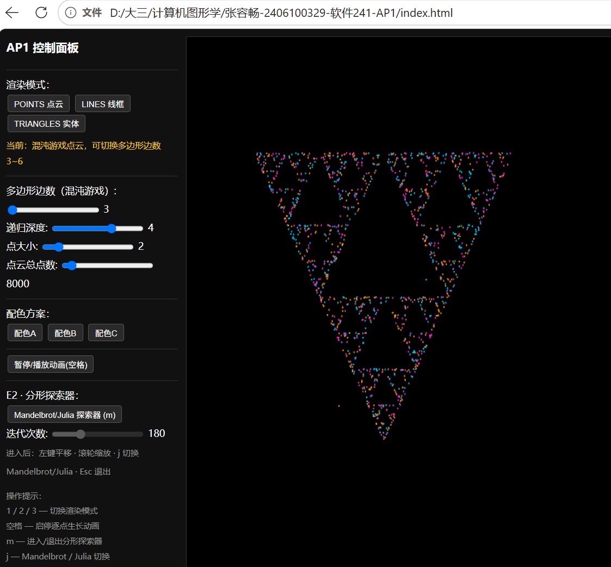
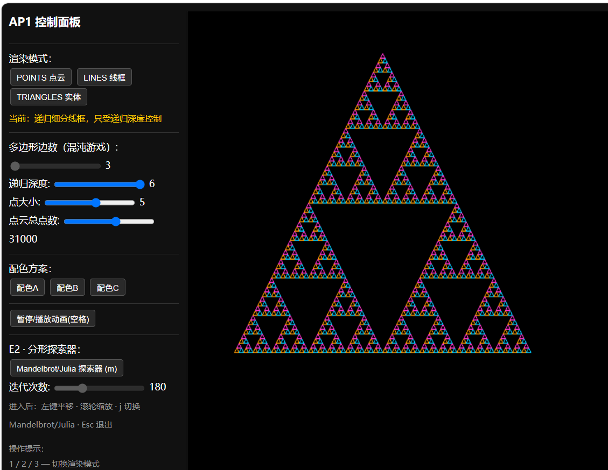
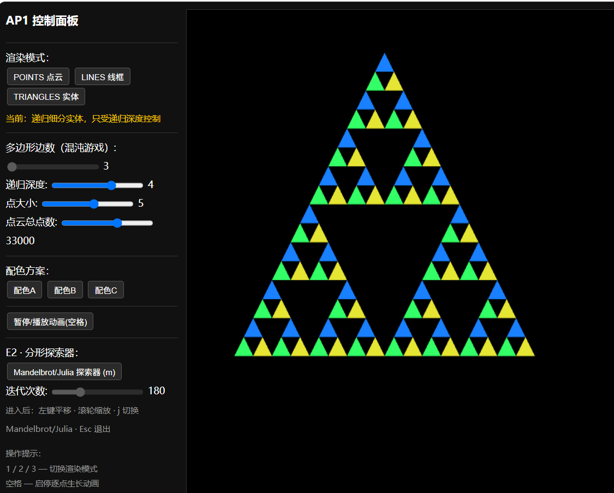
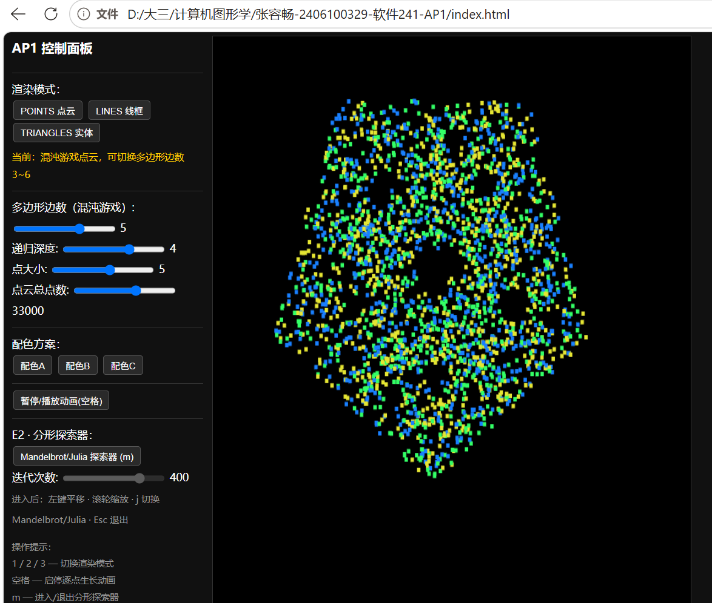
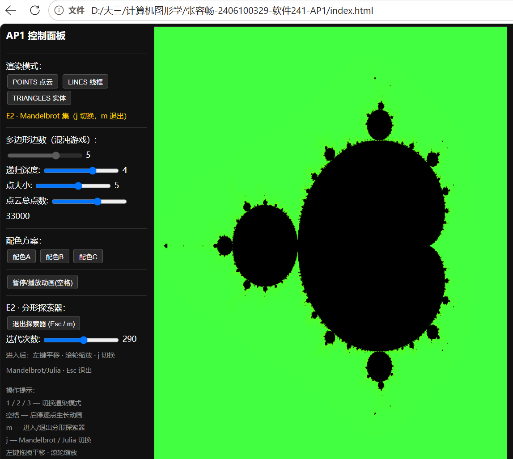

# AP1 · 交互式 2D 分形（Sierpiński 垫片）

> 课程：计算机图形学（Angel & Shreiner, *Interactive Computer Graphics*, 8th ed.）
> 平台：浏览器 + 原生 **WebGL 2.0** + JavaScript（无任何构建步骤，任意静态服务器即可运行）
> 作者：张容畅（2406100329 · 软件241）

本项目实现 **AP1 · 交互式 2D 分形**：用两种经典算法生成 Sierpiński 垫片，
并配合完整的交互控制（参数面板 + 鼠标 + 键盘），另含两项选做扩展
（E1 任意 N 边形混沌游戏、E2 Mandelbrot / Julia 交互探索器）。

---

## 1. 运行方式

项目无构建步骤，任意静态文件服务器即可运行。

**方式一：命令行启动本地服务器（推荐）**

```bash
cd 张容畅-2406100329-软件241-AP1
python -m http.server 8000
# 浏览器打开 http://localhost:8000
```

**方式二：直接双击 `index.html`**（现代浏览器对本地文件也支持 WebGL2）。

**方式三（提交要求）：上传到公网静态托管**（GitHub Pages / Gitee Pages / 个人主页等），
把 `index.html`、`main.js`、`geometry.js`、`fractal.js`、`interaction.js`、`ui.js`、
`shaders.js`、`Common/`、`screenshots/` 一并上传，访问该 URL 即可运行。

> 支持 URL 参数预设初始状态（便于演示）：`?mode=0/1/2`、`?color=0/1/2`、
> `?depth=0~6`、`?n=3~6`、`?fract=1`（进入探索器）、`?julia=1`（切到 Julia 集）。

**浏览器要求**：需支持 WebGL 2.0（Chrome / Edge / Firefox 最新版）。

---

## 2. 实现要点

### 2.1 混沌游戏（Chaos Game）生成 Sierpiński 垫片

算法思想：在一个多边形内部随机取一点作为初始点，然后**反复随机选择多边形的一个顶点**，
执行

```
p = (p + 随机顶点) / 2
```

即每次把当前点向随机选中的顶点方向移动一半距离。重复足够多次（本实现默认 8000，上限 5 万），
点的轨迹会收敛到著名的分形结构——三角形时即为 **Sierpiński 垫片**。

- 初始点随机、每步随机选顶点 → 结果具有"混沌"特性，但最终结构确定。
- 本实现支持 **3~6 边形**（E1 扩展），可切换观察三角形 / 四边形 / 五边形 / 六边形的分形差异。
- 点云以 `gl.POINTS` 图元渲染，点数从 0 逐帧增长到设定值（"逐点生长"动画）。

### 2.2 递归细分（Recursive Subdivision）生成 Sierpiński 垫片

算法思想：从一个初始大三角形出发，取**三条边的中点**并两两相连，挖去中间的小三角形，
得到 3 个更小的三角形；对每个小三角形重复同样的操作 `depth` 次。

```
subdivide(a,b,c):
    ab=(a+b)/2, bc=(b+c)/2, ca=(c+a)/2
    subdivide(a, ab, ca)
    subdivide(ab, b, bc)
    subdivide(ca, bc, c)
```

- 深度 `depth` 由用户通过滑条控制（0~6，深度 ≥4 时三角数量为 3⁴=81，运行流畅不崩溃）。
- **同一组三角形**支持三种渲染模式切换：
  - **点云 `gl.POINTS`**：每个三角形顶点画点；
  - **线框 `gl.LINES`**：对每个三角形输出其 3 条边 `(a,b)、(b,c)、(c,a)`（见 `trianglesToEdges`，避免跨三角形错误连线）；
  - **实体 `gl.TRIANGLES`**：直接填充每个三角形。

### 2.3 渲染管线（最小图形程序结构）

遵循"应用程序 → 顶点数据 → 渲染"的最小结构：

1. 在 JS 中用数组（`Float32Array`）组织顶点坐标与颜色（`gl.bufferData` 上传到 VBO）；
2. 顶点着色器 `aPosition` / `aColor` 取数据，用 `uModelMatrix` 做缩放 + 平移（`mat3`）；
3. 片元着色器输出顶点颜色；
4. 依据模式调用 `gl.drawArrays(gl.POINTS / LINES / TRIANGLES)`。

### 2.4 选做扩展

- **E1 · 任意 N 边形混沌游戏**：滑条 3~6 边形，顶点按正多边形均匀分布，观察不同边数的垫片形态。
- **E2 · Mandelbrot / Julia 交互探索器**：用铺满屏幕的三角形 + 片元着色器逐像素迭代复数映射 `z = z² + c`，
  支持缩放 / 平移与三套配色映射；`j` 一键在 Mandelbrot（z₀=0，c 随像素）与 Julia（z₀ 随像素，c 固定）之间切换，
  滑条可调迭代次数（影响细节精细度与性能）。

---

## 3. 交互操作说明

| 交互 | 操作 | 说明 |
|---|---|---|
| **渲染模式** | 按钮 / 按键 `1` `2` `3` | `1`=点云(混沌游戏) `2`=线框(细分) `3`=实体(细分) |
| **动画** | 按钮 / 按键 `空格` | 暂停 / 继续"逐点生长"动画（点云从 0 增长到设定值） |
| **平移** | 鼠标左键拖拽 | 移动视图 |
| **缩放** | 鼠标滚轮 | 以光标为中心放大 / 缩小 |
| **配色** | 配色 A/B/C 按钮 | 三套预设配色方案 |
| **参数** | 滑条 | 边数、递归深度、点大小、点云总点数 |
| **E2 探索器** | 按键 `m` / 按钮 | 进入 / 退出 Mandelbrot / Julia（`Esc` 也可退出） |
| **Mandelbrot↔Julia** | 按键 `j` | 在探索器内切换两种集合 |
| **迭代次数** | 滑条（探索器内可用） | 调整分形细节 |

---

## 4. 效果截图

**① 点云模式（混沌游戏生成 Sierpiński 垫片）**



**② 线框模式（递归细分，深度 6）**



**③ 实体模式（递归细分，深度 4）**



**④ E1 扩展：五边形混沌游戏（多边形边数 = 5）**



**⑤ E2 扩展：Mandelbrot 集探索器**



---

## 5. 文件结构

```
张容畅-2406100329-软件241-AP1/
├── index.html          # 页面结构、控制面板、脚本加载
├── main.js             # WebGL 初始化、全局状态、渲染主循环、动画
├── geometry.js         # 几何：混沌游戏 / 递归细分 / 配色（纯计算，无 DOM）
├── fractal.js          # E2：Mandelbrot / Julia 片元着色器与绘制
├── interaction.js      # 鼠标 / 键盘事件
├── ui.js               # 控制面板回调、滑块绑定、URL 参数、初始化
├── shaders.js          # 2D 分形顶点 / 片元着色器源码
├── Common/             # 教材配套工具库（见 6. 引用说明）
│   ├── initShaders.js
│   ├── MV.js
│   └── webgl-utils.js
└── screenshots/        # 各渲染模式截图
```

代码按"几何 / 交互 / UI"分文件组织，全局状态集中在 `state` 对象中管理。

---

## 6. 引用说明

- `Common/` 目录下的 `initShaders.js`、`MV.js`、`webgl-utils.js` 为教材配套工具库
  （Angel & Shreiner, *Interactive Computer Graphics*, 8th ed.），按课程要求直接使用。
- `main.js`、`geometry.js`、`fractal.js`、`interaction.js`、`ui.js`、`shaders.js`、`index.html`
  均由本人独立编写；混沌游戏、递归细分、Mandelbrot / Julia 算法为教材与公开的经典算法思想，
  代码实现为本人的原创表达。

---

## 7. 评分对照

| 评分维度 | 完成情况 |
|---|---|
| 算法正确性（3） | 混沌游戏 + 递归细分两种算法均正确；深度 0~6，≥4 不崩溃 |
| 交互完整性（3） | 参数面板、鼠标（拖拽 / 滚轮）、键盘（1/2/3、空格）三类交互齐全且响应正确 |
| 代码质量（2） | 几何 / 交互 / UI 分文件，全局状态集中管理，无全局变量滥用 |
| README 与演示（1） | 本文件完整，含运行方式、原理、交互、截图 |
| 选做扩展（+2） | E1（N 边形混沌游戏）+ E2（Mandelbrot / Julia 探索器）均已实现 |
